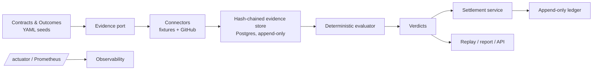
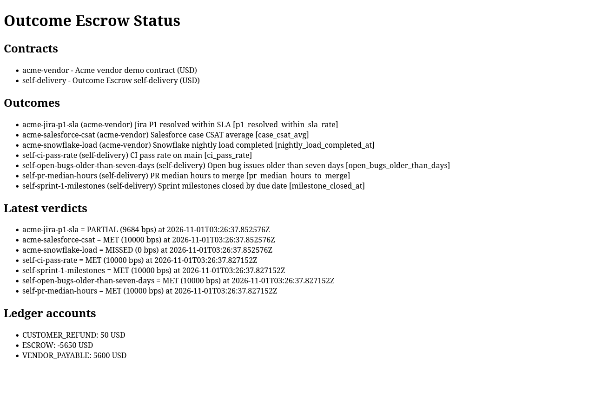
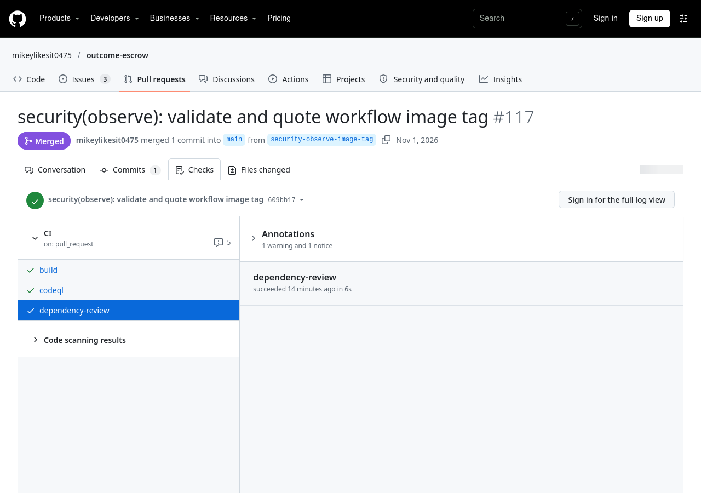
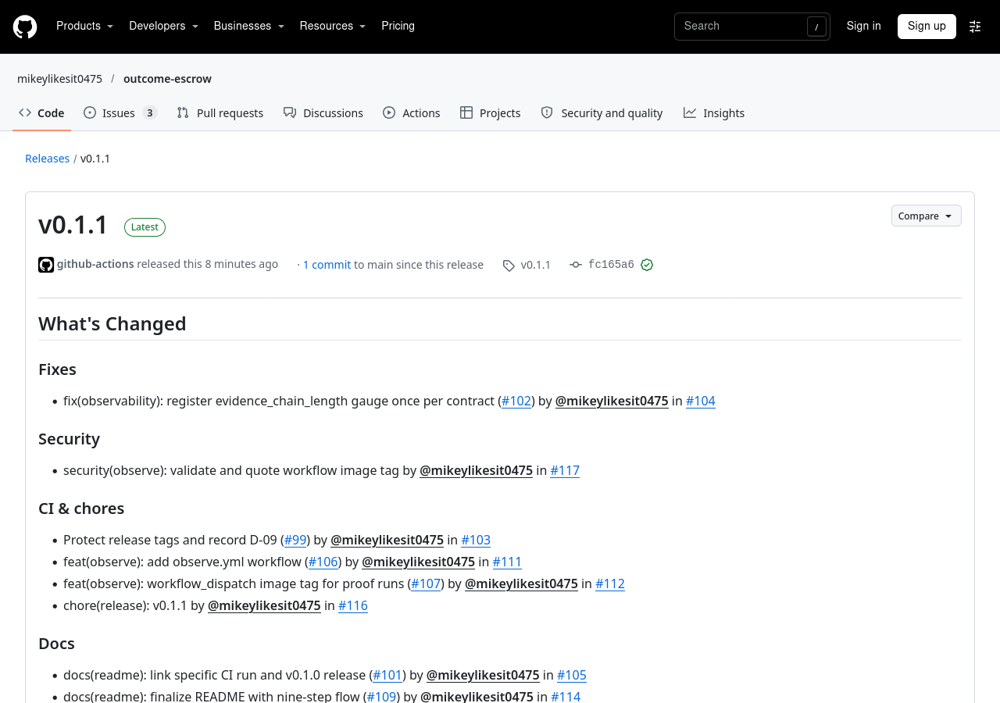
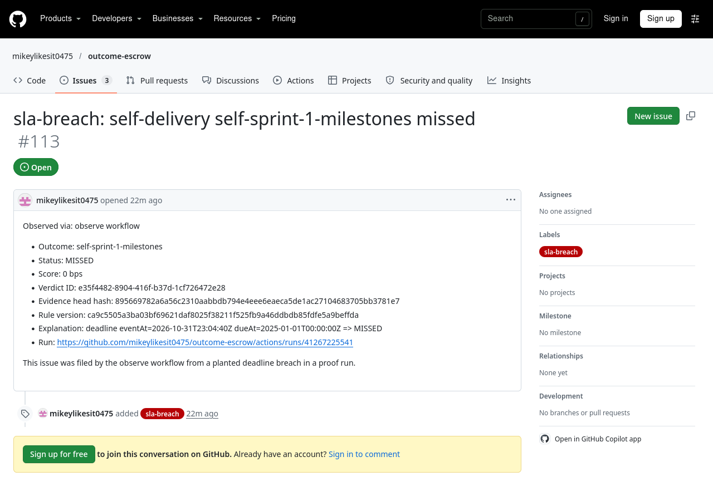

# outcome-escrow


Outcome-based IT vendor & SLA tracker built on Java 25 / Spring Boot 4.1 / PostgreSQL 16 / Gradle 9.8. Contracts declare machine-checkable outcomes, evidence is pulled from enterprise systems into a hash-chained store, a deterministic evaluator issues replayable verdicts, and an append-only escrow ledger pays out by tier or claws back.

**Status: v0.1.1 released.** See [`docs/GITHUB_FLOW.md`](docs/GITHUB_FLOW.md) for the full nine-step engineering flow this repository demonstrates.

## Problem

Vendor SLAs are usually tracked in spreadsheets and argued about later. Outcome Escrow turns a contract into executable rules: pull real evidence, score the outcome, settle funds automatically, and make every verdict replayable from its stored evidence.

## Architecture



## Quickstart & demo

```bash
docker compose up --build
# seed contracts are loaded on startup
curl -s http://localhost:8080/contracts
curl -s -X POST http://localhost:8080/contracts/self-delivery/evidence:pull
curl -s -X POST http://localhost:8080/contracts/self-delivery/evaluate
curl -s http://localhost:8080/contracts/self-delivery/report
curl -s http://localhost:8080/actuator/prometheus | grep evaluations_total
curl -s http://localhost:8080/actuator/health
gh issue list --label sla-breach --state all
gh release view v0.1.1
gh workflow run observe.yml
```

### Sample contract (excerpt)

```yaml
outcomes:
  - id: self-ci-pass-rate
    rule:
      type: WindowedRate
      numeratorMetric: ci_pass_rate
      denominatorMetric: ci_pass_rate
      operator: AT_LEAST
      target: 0.95
    tiers:
      - minimumScore: 9500
        payoutBasisPoints: 10000
```

### Sample report output

```text
# Settlement report for self-delivery

## Outcome self-ci-pass-rate - CI pass rate on main
Milestone value: 1000 USD
Rule: {"type":"WindowedRate","numeratorMetric":"ci_pass_rate","denominatorMetric":"ci_pass_rate","operator":"AT_LEAST","target":0.95}
Latest verdict: MET (10000 bps)
Evidence head hash: 9b3f8c0d1e9a6f4...
Rule version: eval-0.1.0
Explanation: CI pass rate 14/14 (100%) meets AT_LEAST 95%.

## Ledger balances
- ESCROW: 4000 USD
- VENDOR_PAYABLE: 1000 USD
```
```

## API table

| Method | Path | Purpose |
|---|---|---|
| GET | `/contracts` | List contracts |
| GET | `/contracts/{id}` | Contract detail |
| GET | `/contracts/{id}/outcomes` | Outcomes and rules |
| GET | `/contracts/{id}/evidence` | Evidence chain |
| GET | `/contracts/{id}/evidence/verify` | Verify chain integrity |
| POST | `/contracts/{id}/evidence:pull` | Pull evidence |
| POST | `/contracts/{id}/evaluate` | Evaluate all outcomes |
| GET | `/contracts/{id}/verdicts` | Verdict history |
| POST | `/verdicts/{id}/replay` | Replay a verdict |
| GET | `/contracts/{id}/report` | Markdown settlement report |
| GET | `/ledger/balances` | Ledger balances |
| GET | `/status` | Service status and balances |
| GET | `/actuator/health` | Health |
| GET | `/actuator/prometheus` | Metrics |

## GitHub flow

Every change lands through a branch, draft PR, CI, review and squash merge. Example: [PR #75](https://github.com/mikeylikesit0475/outcome-escrow/pull/75) carried Sprint 3 settlement and was merged with green checks. A green run on a later ready PR is [run 41266454264](https://github.com/mikeylikesit0475/outcome-escrow/actions/runs/41266454264); the first released tag ran via [41264810544](https://github.com/mikeylikesit0475/outcome-escrow/actions/runs/41264810544) to the [v0.1.0 release page](https://github.com/mikeylikesit0475/outcome-escrow/releases/tag/v0.1.0), and the current released tag ran via [41268490235](https://github.com/mikeylikesit0475/outcome-escrow/actions/runs/41268490235) to the [v0.1.1 release page](https://github.com/mikeylikesit0475/outcome-escrow/releases/tag/v0.1.1).

- Plan: [`MASTER_SCRUM.md`](MASTER_SCRUM.md)
- Design: [`docs/ARCHITECTURE.md`](docs/ARCHITECTURE.md)
- Flow: [`docs/GITHUB_FLOW.md`](docs/GITHUB_FLOW.md)


## GitHub flow: nine steps

| Step | What you'd inspect | Link |
|---|---|---|
| 1. Plan | Sprint tracking issue, milestones, issue labels | [#6 tracking](https://github.com/mikeylikesit0475/outcome-escrow/issues/6) |
| 2. Branch | Feature branch plus protected main | `gh ruleset view protect-main` |
| 3. Develop | `./gradlew check` | [CI workflow](.github/workflows/ci.yml) |
| 4. Push + PR | Draft PR with `Closes #N` | [PR #75](https://github.com/mikeylikesit0475/outcome-escrow/pull/75) |
| 5. CI | build, CodeQL, dependency-review | [run 41266454264](https://github.com/mikeylikesit0475/outcome-escrow/actions/runs/41266454264) |
| 6. Review | PR template self-review checklist plus architect acceptance review | [Sprint 4 acceptance comment on #5](https://github.com/mikeylikesit0475/outcome-escrow/issues/5#issuecomment-6552375939) |
| 7. Merge | Squash merge with branch deletion | `gh repo view --json deleteBranchOnMerge` |
| 8. Release | GHCR image and GitHub release | [v0.1.1 release](https://github.com/mikeylikesit0475/outcome-escrow/releases/tag/v0.1.1) (initial tag: [v0.1.0](https://github.com/mikeylikesit0475/outcome-escrow/releases/tag/v0.1.0)) |
| 9. Observe | Scheduled `observe.yml` filing `sla-breach` issues | [Issue #113](https://github.com/mikeylikesit0475/outcome-escrow/issues/113) |

Step 6 is intentionally single-authorship, not a teammate review: the PR stays in draft until the checklist in `PULL_REQUEST_TEMPLATE.md` is satisfied, and an architect acceptance record is posted on the sprint tracking issue (for example, the Sprint 4 acceptance comment on #5). Planning and acceptance gates therefore stay separate from implementation execution.

## Evidence from a real run


Status page from the released `v0.1.1` image, showing the partial tier and named ledger balances.


CI evidence for the late security fix: build, CodeQL and dependency-review are all green on PR #117.


The v0.1.1 release page produced by the tag-driven workflow.


Issue #113 as filed by `observe.yml` from a planted breach on a proof run, including its contract evidence hash and rule version.

- Auto-filed observe issue: [#113](https://github.com/mikeylikesit0475/outcome-escrow/issues/113) was filed by `observe.yml` from a **planted** breach on a `workflow_dispatch` proof run (deadline `2025-01-01` in `self-delivery.yaml` on a proof image/branch, not `main`). The scheduled run against the real contract (run `41269036605`) found no breach and filed nothing, and did not duplicate #113. The fix-to-release half of the loop was exercised by security finding #117 → v0.1.1 rather than by #113.
- Release page: [v0.1.1](https://github.com/mikeylikesit0475/outcome-escrow/releases/tag/v0.1.1)
- Green CI check: [run 41266454264](https://github.com/mikeylikesit0475/outcome-escrow/actions/runs/41266454264)

