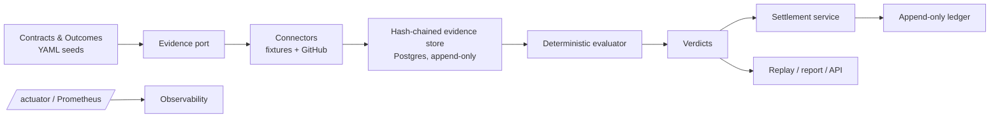

# outcome-escrow


Outcome-based IT vendor & SLA tracker. Contracts declare machine-checkable outcomes, evidence is pulled from enterprise systems into a hash-chained store, a deterministic evaluator issues replayable verdicts, and an append-only escrow ledger pays out by tier or claws back.

**Status: v0.1.1 released.** See [`docs/GITHUB_FLOW.md`](docs/GITHUB_FLOW.md) for the full nine-step engineering flow this repository demonstrates.

## Problem

Vendor SLAs are usually tracked in spreadsheets and argued about later. Outcome Escrow turns a contract into executable rules: pull real evidence, score the outcome, settle funds automatically, and make every verdict replayable from its stored evidence.

## Architecture



## 90-second demo

```bash
docker compose up --build
# seed contracts are loaded on startup
curl -s http://localhost:8080/contracts
curl -s -X POST http://localhost:8080/contracts/self-delivery/evidence:pull
curl -s -X POST http://localhost:8080/contracts/self-delivery/evaluate
curl -s http://localhost:8080/contracts/self-delivery/report
curl -s http://localhost:8080/actuator/prometheus | grep evaluations_total
```

## API table

| Method | Path | Purpose |
|---|---|---|
| GET | `/contracts` | List contracts |
| GET | `/contracts/{id}` | Contract detail |
| GET | `/contracts/{id}/outcomes` | Outcomes and rules |
| GET | `/contracts/{id}/evidence` | Evidence chain |
| GET | `/contracts/{id}/evidence/verify` | Verify chain integrity |
| POST | `/contracts/{id}/evidence:pull` | Pull evidence |
| POST | `/contracts/{id}/evaluate` | Evaluate all outcomes |
| GET | `/contracts/{id}/verdicts` | Verdict history |
| POST | `/verdicts/{id}/replay` | Replay a verdict |
| GET | `/contracts/{id}/report` | Markdown settlement report |
| GET | `/ledger/balances` | Ledger balances |
| GET | `/status` | Service status and balances |
| GET | `/actuator/health` | Health |
| GET | `/actuator/prometheus` | Metrics |

## GitHub flow

Every change lands through a branch, draft PR, CI, review and squash merge. Example: [PR #75](https://github.com/mikeylikesit0475/outcome-escrow/pull/75) carried Sprint 3 settlement and was merged with green checks. A green run on a later ready PR is [run 41266454264](https://github.com/mikeylikesit0475/outcome-escrow/actions/runs/41266454264); the v0.1.0 release run is [41264810544](https://github.com/mikeylikesit0475/outcome-escrow/actions/runs/41264810544), published on the [v0.1.0 release page](https://github.com/mikeylikesit0475/outcome-escrow/releases/tag/v0.1.0).

- Plan: [`MASTER_SCRUM.md`](MASTER_SCRUM.md)
- Design: [`docs/ARCHITECTURE.md`](docs/ARCHITECTURE.md)
- Flow: [`docs/GITHUB_FLOW.md`](docs/GITHUB_FLOW.md)


## GitHub flow: nine steps

| Step | What you'd inspect | Link |
|---|---|---|
| 1. Plan | Sprint tracking issue, milestones, issue labels | [#6 tracking](https://github.com/mikeylikesit0475/outcome-escrow/issues/6) |
| 2. Branch | Feature branch plus protected main | `gh ruleset view protect-main` |
| 3. Develop | `./gradlew check` | [CI workflow](.github/workflows/ci.yml) |
| 4. Push + PR | Draft PR with `Closes #N` | [PR #75](https://github.com/mikeylikesit0475/outcome-escrow/pull/75) |
| 5. CI | build, CodeQL, dependency-review | [run 41266454264](https://github.com/mikeylikesit0475/outcome-escrow/actions/runs/41266454264) |
| 6. Review | Copilot review requests | `gh pr view <n> --json reviewRequests` |
| 7. Merge | Squash merge with branch deletion | `gh repo view --json deleteBranchOnMerge` |
| 8. Release | GHCR image and GitHub release | [v0.1.0 release](https://github.com/mikeylikesit0475/outcome-escrow/releases/tag/v0.1.0) |
| 9. Observe | Scheduled `observe.yml` filing `sla-breach` issues | [Issue #113](https://github.com/mikeylikesit0475/outcome-escrow/issues/113) |

## Evidence from a real run

- Status page: [`/status`](http://localhost:8080/status) (service running locally)
- Auto-filed observe issue: [#113](https://github.com/mikeylikesit0475/outcome-escrow/issues/113)
- Release page: [v0.1.0](https://github.com/mikeylikesit0475/outcome-escrow/releases/tag/v0.1.0)
- Green CI check: [run 41266454264](https://github.com/mikeylikesit0475/outcome-escrow/actions/runs/41266454264)

## Two-minute demo script

1. `docker compose up --build`
2. `curl -s http://localhost:8080/contracts`
3. `curl -s -X POST http://localhost:8080/contracts/self-delivery/evidence:pull`
4. `curl -s -X POST http://localhost:8080/contracts/self-delivery/evaluate`
5. `curl -s http://localhost:8080/contracts/self-delivery/report`
6. `curl -s http://localhost:8080/actuator/prometheus | grep evaluations_total`
7. `curl -s http://localhost:8080/actuator/health`
8. `gh issue list --label sla-breach --state all`
9. `gh release view v0.1.0`
10. `gh workflow run observe.yml`
